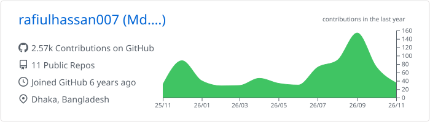
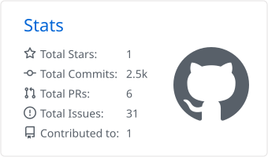
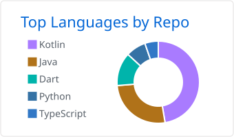
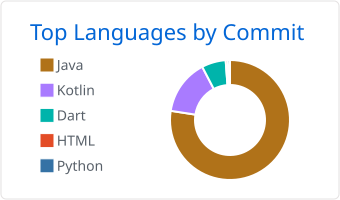
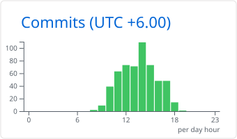

# Md. Rafiul Hassan

**Software Engineer · Java & Spring Boot · Android & Kotlin · Odoo ERP**

---

## About Me

I build scalable backend systems, enterprise applications and mobile apps. My core is **Java, Spring Boot, Android and Kotlin**, with hands-on experience in ERP and University Management Systems, database performance, and maintainable architecture.

- 🔭 Working on Spring Boot backends and mobile applications
- 🌱 Learning Flutter, AI integration and modern software architecture
- 🤖 Exploring local LLMs, Ollama, RAG and embeddings
- 💡 Interested in microservices, distributed systems and query optimization
- 🧪 Care about clean code, TDD and software quality
- 📍 Dhaka, Bangladesh 🇧🇩

---

## Tech Stack

   
   
   
  

| Area | Focus |
| --- | --- |
| **Backend** | Java, Spring Boot, Spring Security, REST APIs, JPA/Hibernate, JWT, microservices |
| **Mobile** | Android SDK, Kotlin, MVVM, Retrofit, Room, Dagger Hilt, Flutter |
| **Data** | Microsoft SQL Server, PostgreSQL, MySQL, SQLite, stored procedures, query tuning |
| **ERP** | Odoo 13 / 14 / 15 / 16, custom modules, business process automation |
| **AI** | Ollama, local LLMs, RAG, embeddings |

---

## What I Work On

| Focus | What I do |
| --- | --- |
| 🏢 **Enterprise Systems** | ERP and University Management Systems: admission, academic and HR solutions |
| ⚙️ **Backend Engineering** | Secure, scalable REST APIs with Spring Boot, JPA/Hibernate and stored procedures; query optimization on SQL Server and PostgreSQL |
| 📱 **Mobile Engineering** | Android apps with Kotlin, MVVM, Retrofit, Room and Dagger Hilt; learning Flutter |
| 🧩 **Odoo ERP** | Custom modules and business process automation across Odoo 13 to 16 |
| 🤖 **AI Integration** | Local LLMs with Ollama, RAG and embeddings for AI-powered applications |

> Much of my recent work lives in private repositories, so my public repos only show a small part of it. The stats below include private contributions.

---

## GitHub Stats

<picture>
  <source media="(prefers-color-scheme: dark)" srcset="./profile-summary-card-output/github_dark/0-profile-details.svg">
  
</picture>
<picture>
  <source media="(prefers-color-scheme: dark)" srcset="./profile-summary-card-output/github_dark/3-stats.svg">
  
</picture>

<picture>
  <source media="(prefers-color-scheme: dark)" srcset="./profile-summary-card-output/github_dark/1-repos-per-language.svg">
  
</picture>
<picture>
  <source media="(prefers-color-scheme: dark)" srcset="./profile-summary-card-output/github_dark/2-most-commit-language.svg">
  
</picture>

<picture>
  <source media="(prefers-color-scheme: dark)" srcset="./profile-summary-card-output/github_dark/4-productive-time.svg">
  
</picture>

## Contribution Activity

<picture>
  <source media="(prefers-color-scheme: dark)" srcset="https://raw.githubusercontent.com/rafiulhassan007/rafiulhassan007/output/github-snake-dark.svg">
  
</picture>

---

## Certifications

- ISTQB Certified Software Tester
- Odoo Functional Certification
- Android Application Development, NASSCOM

*Building solutions, one commit at a time.*

